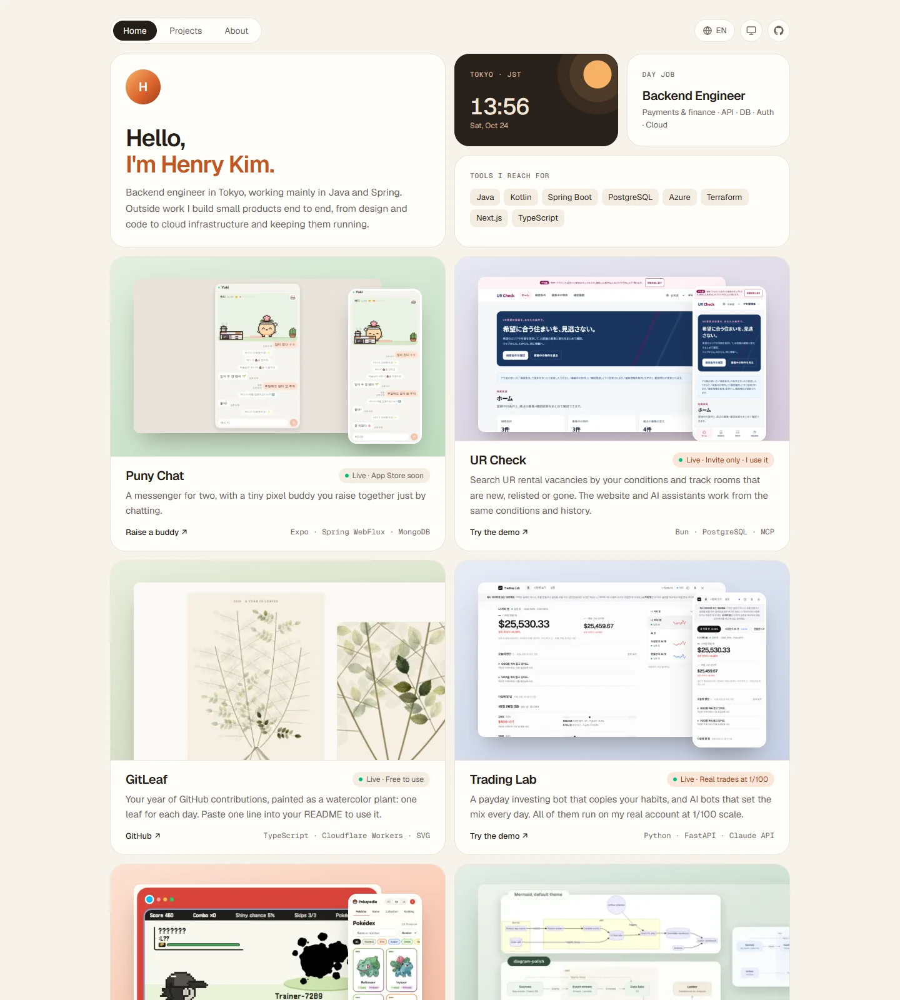

### Hi, I'm Henry Kim 👋

Backend engineer in Tokyo. At work I build payment and finance systems with Java, Kotlin and Spring. After hours I build small products of my own, and keep them running.

Before software, I spent my twenties as a hairstylist.

**Portfolio** → [portfolio-hub.dev](https://www.portfolio-hub.dev)  
**Writing** → [hukutaku.tistory.com](https://hukutaku.tistory.com/)

#### Things I've built

- **[Puny Chat](https://puny-chat.com)** — A messenger for two, with a tiny pixel buddy you raise together just by chatting. iPhone and web, in Korean, English, Japanese and Chinese.  
  Expo · Spring WebFlux · MongoDB Atlas · AWS Lightsail · Cloudflare
- **[UR Check](https://www.portfolio-hub.dev/projects/ur-check)** — Search UR rental vacancies by your conditions and keep track of rooms that are new, relisted or gone. The website and AI assistants share the same conditions. Invite only; it grew out of UR Manager and UR MCP App. [Demo](https://demo.ur-check.com)  
  Bun · Hono · PostgreSQL · React · MCP · AWS Lightsail
- **[GitLeaf](https://www.portfolio-hub.dev/projects/gitleaf)** — Paints your year of GitHub contributions as a watercolor plant, one leaf for each day. Paste one line into your README to use it. [Source](https://github.com/ottuck/gitleaf)  
  TypeScript · Cloudflare Workers · D1 · R2 · SVG
- **[Trading Lab](https://demo.trading-lab.me)** — A payday investing bot for US stocks that copies your habits, next to two AI bots that set the mix every day: one reads the news, the other sees only the charts. They run on my real account at 1/100 scale; the demo runs on synthetic prices.  
  Python · FastAPI · PostgreSQL · React · Claude API · Docker · AWS Lightsail
- **[Pokepedia](https://pokepedia.dev)** — A Game Boy–style “Who's that Pokémon?” quiz with a Gen 1 Pokédex, in Korean, English and Japanese. Win a Pikachu and it fights Blastoise in a turn-based battle built in Unity. [Source](https://github.com/ottuck/pokepedia) · [Battle source](https://github.com/ottuck/pokepedia-unity)  
  Next.js · Supabase · Vercel · Unity (C#) · WebGL · Cloudflare Pages
- **[diagram-polish](https://www.portfolio-hub.dev/projects/diagram-polish)** — A Claude Code skill that turns a Mermaid block or a README sketch into a clean architecture diagram: boxes and arrows in JSON, SVG and PNG out. [Source](https://github.com/ottuck/diagram-polish)  
  Claude Code · Node.js · SVG
- **[Henry Wallet](https://www.portfolio-hub.dev/projects/henry-wallet)** — A self-custody stablecoin wallet for iPhone. It holds USDC and JPYC, keeps the keys on the phone and signs every payment there after Face ID. On testnets for now. [Demo](https://wallet.portfolio-hub.dev) · [Source](https://github.com/ottuck/stable-wallet)  
  Expo · TypeScript · ethers · Polygon · Ethereum · Avalanche

#### Usually working with

Java · Kotlin · Spring Boot · PostgreSQL · Azure · Terraform · Next.js · TypeScript

 

<a href="https://www.portfolio-hub.dev">
  <picture>
    <source media="(prefers-color-scheme: dark)" srcset="images/portfolio-dark.webp" />
    
  </picture>
</a>

<a href="https://www.portfolio-hub.dev"><b>See the projects at portfolio-hub.dev →</b></a>

 

  

